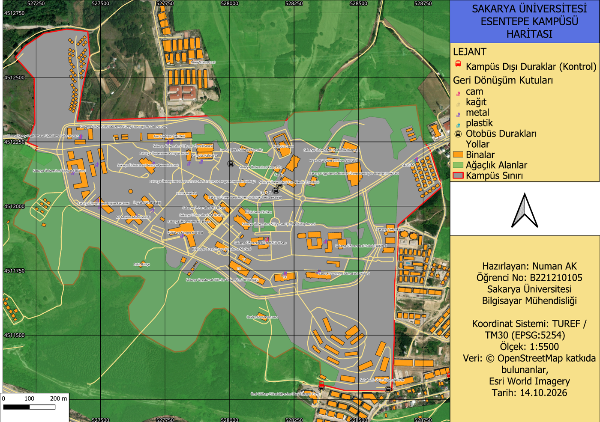

# Sakarya Üniversitesi Esentepe Kampüsü Haritası – QGIS

QGIS kullanılarak Sakarya Üniversitesi Esentepe Kampüsü için hazırlanmış sayısal harita ve veri kontrol uygulamaları.

## İçerik

| Dosya | Açıklama |
|---|---|
| `sau_kampus.qgz` | QGIS proje dosyası |
| `sau_kampus.gpkg` | Tüm katmanları içeren GeoPackage veritabanı |
| `SAU_Kampus_Pafta.pdf` | A3 yatay harita paftası (1:5500) |
| `SAU_Kampus_Rapor_Numan_AK.pdf` | Ödev raporu |

## Katmanlar

| Katman | Geometri | Kaynak |
|---|---|---|
| kampus_siniri | Çokgen | OpenStreetMap |
| binalar | Çokgen | OpenStreetMap (637 bina) |
| agaclik_alanlar | Çokgen | OpenStreetMap |
| yollar | Çizgi | OpenStreetMap |
| otobus_duraklari | Nokta | OpenStreetMap |
| geri_donusum | Nokta | Uydu görüntüsü üzerinde elle sayısallaştırma |
| kampus_disi_duraklar | Nokta | Konumsal analiz çıktısı |

Koordinat sistemi: **TUREF / TM30 (EPSG:5254)**

## Kontrol Uygulamaları

**Öznitelik formu kontrolleri**
- Değer haritaları (atık türü, durum) ve zorunlu alanlar
- Aralık widget'ı + ifade kısıtları (`kat_sayisi BETWEEN 1 AND 20`, `kapasite_lt BETWEEN 50 AND 1100`)
- Otomatik hesaplanan, düzenlenemez alanlar (`round($area, 2)`, `round($length, 2)`)
- Benzersiz durak adı kısıtı

**Topoloji kontrolleri** (Topology Checker Pro)
- Boş / geçersiz geometri, örtüşme, kendi kendini kesme, çift geometri
- Sonuç: binalarda 3, ağaçlık alanlarda 2 hata tespit edildi

**Konumsal analiz**
- "Konuma göre çıkart" (disjoint) ile kampüs sınırı dışında kalan 7 otobüs durağı belirlendi

## Nasıl Açılır

1. [QGIS 3.44 LTR](https://qgis.org) kurun.
2. Repoyu indirin (**Code → Download ZIP**) ve klasöre çıkarın.
3. `sau_kampus.qgz` dosyasını açın. `.gpkg` dosyası proje ile aynı klasörde olmalıdır.

## Araçlar

QGIS 3.44.15 LTR · QuickOSM · QuickMapServices · Topology Checker Pro

## Veri Kaynakları

- © [OpenStreetMap](https://www.openstreetmap.org/copyright) katkıda bulunanlar (ODbL)
- Esri World Imagery

## Hazırlayan

**Numan AK** – Sakarya Üniversitesi, Bilgisayar Mühendisliği · Ekim 2026
